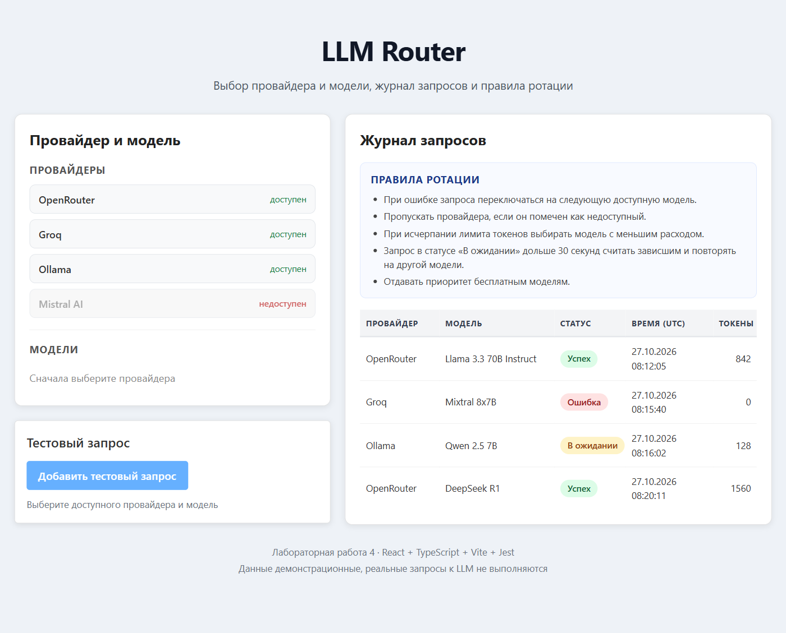
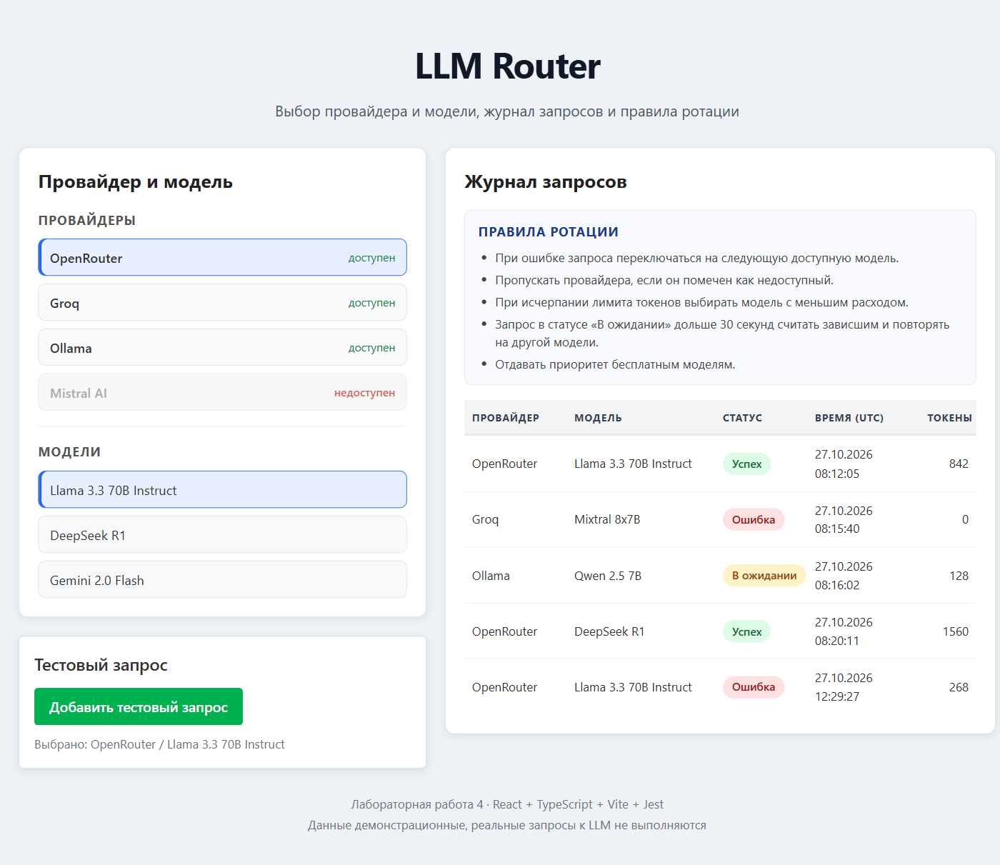

# Lab 4 — LLM Router (student 19)

Лабораторная работа 4: библиотека React-компонентов и демонстрационное приложение для
выбора LLM-провайдера/модели и просмотра журнала запросов.

## Что реализовано

Библиотека `ui-library` содержит два новых компонента:

- **`ProviderModelPanel`** — панель выбора провайдера и модели.
  Показывает список провайдеров, признак доступности, список моделей выбранного
  провайдера, активный выбор. Недоступного провайдера и его модели выбрать нельзя.
- **`RequestLog`** — журнал запросов к LLM. Показывает провайдера, модель, статус,
  время и количество токенов, а также блок правил ротации. Данные приходят только
  через `props`; при пустом списке выводится «Пусто».

Демо-приложение `frontend` показывает оба компонента вместе: выбор пары
«провайдер + модель», добавление тестового запроса и журнал с правилами ротации.

## Контракты компонентов

### `ProviderModelPanel`

```ts
interface LLMProvider {
  id: string
  name: string
  available: boolean
}

interface LLMModel {
  id: string
  providerId: string
  name: string
}

interface ProviderModelPanelProps {
  providers: LLMProvider[]
  models: LLMModel[]
  selectedProviderId: string | null
  selectedModelId: string | null
  onProviderSelect: (providerId: string) => void
  onModelSelect: (modelId: string) => void
}
```

### `RequestLog`

```ts
type LLMRequestStatus = 'success' | 'error' | 'pending'

interface LLMRequest {
  id: string
  provider: string
  model: string
  status: LLMRequestStatus
  createdAt: string
  tokens: number
}

interface RequestLogProps {
  requests: LLMRequest[]
  rotationRules: string[]
}
```

## Структура проекта

```text
solutions/student-19/
├── docs/                    # скриншоты для README
├── frontend/                # демо-приложение (Vite + React + TS)
│   └── src/
│       ├── App.tsx          # состояние выбора и добавление тестового запроса
│       ├── App.test.tsx
│       └── data.ts          # мок-провайдеры, модели, запросы и правила
└── ui-library/              # библиотека компонентов
    └── src/
        ├── Button/
        ├── Card/
        ├── ProviderModelPanel/
        └── RequestLog/
```

## Запуск

Требуется Node.js и npm. Команды выполняются из папки `solutions/student-19`.

### 1. Сборка библиотеки

```sh
cd ui-library
npm install
npm run build
```

После сборки должны появиться `dist/index.js`, `dist/index.d.ts` и `dist/index.css`.

### 2. Запуск демо-приложения

```sh
cd ../frontend
npm install
npm run dev
```

Приложение откроется на `http://localhost:5173`.

Для разработки библиотеки удобно держать отдельный терминал:

```sh
cd ui-library
npm run dev
```

`vite build --watch` будет пересобирать `dist` при изменении исходников.

### 3. Проверки

В каждой из папок `ui-library` и `frontend`:

```sh
npm run lint
npm run test
npm run build
```

Покрытие:

```sh
npm run test:coverage
```

## Скриншоты

Начальное состояние: провайдер ещё не выбран, поэтому список моделей скрыт.



Выбрана пара OpenRouter / Llama 3.3 70B Instruct и добавлен тестовый запрос.



## Результаты проверок

- `npm run lint` — без ошибок и предупреждений в обоих пакетах.
- `npm run test` — 22 теста библиотеки и 5 тестов приложения проходят.
- `npm run build` — библиотека и приложение собираются.
- Coverage новых компонентов — 100% по statements, branches, functions и lines.
- `any`, `require`, `var` и сторонние UI-библиотеки не используются.
